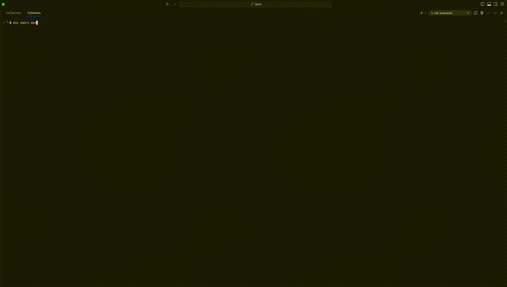

# ExTauri

**Build native desktop applications with Phoenix and Elixir.**

ExTauri wraps [Tauri](https://tauri.app) to enable Phoenix LiveView applications to run as native desktop apps on macOS, Windows, and Linux.

**Website:** feature showcase, installation guide, and API tour — source in [website/](website/), built with [Francis](https://francis.build).



## Features

- **Phoenix LiveView as Desktop Apps** — Turn your Phoenix app into a native desktop application
- **Desktop APIs from Elixir** — Notifications, dialogs, clipboard, filesystem, window management, global shortcuts, and more — with callback-style responses (`use ExTauri.LiveView`), no JavaScript required
- **Server-Side Desktop Channel** — `ExTauri.Desktop` sends notifications and drives the system tray from GenServers and background jobs, no browser involved
- **One-Command Plugin Setup** — `mix ex_tauri.add dialog fs` wires the Rust side for you (Cargo dep, plugin registration, permissions)
- **Native Events in LiveView** — Subscribe to drag-and-drop, deep links, or custom Rust events and handle them like any other LiveView event
- **True Hot Reload** — `mix ex_tauri.dev` runs your Phoenix dev server inside the native window: code reloading and live reload just work
- **Multi-Window** — Open and close secondary native windows from LiveView
- **Single Binary Distribution** — Uses [Burrito](https://github.com/burrito-elixir/burrito) to bundle everything into one executable — or [ampoule](https://github.com/filipecabaco/ampoule), which runs the BEAM as WebAssembly on OTP 28 with nothing to unpack
- **iPhone and iPad** — `mix ex_tauri.ios` runs the same app in the iOS simulator and on real devices, with the BEAM running inside the app; see the [iOS guide](guides/ios.md)
- **Graceful Shutdown** — Heartbeat-based mechanism ensures clean shutdown on CMD+Q, crashes, or force-quit
- **Automated Setup** — Uses [Igniter](https://hexdocs.pm/igniter) for safe, AST-aware project configuration
- **Cross-Platform** — Build for macOS, Windows, and Linux; run on iPhone and iPad

## Prerequisites

- **Elixir** >= 1.17 with **OTP 27** (OTP 28 not yet supported due to Burrito ERTS availability)
- **Rust** — [Install via rustup](https://www.rust-lang.org/tools/install)
- **Zig 0.16.0**, exactly — Burrito 1.6 builds the packaged sidecar with it and refuses any other version
- **Platform dependencies** — see [Tauri prerequisites](https://v2.tauri.app/start/prerequisites/)

> **Note:** `mix ex_tauri.dev` skips Burrito, so Zig is only needed for `mix ex_tauri.build`.
>
> With the [ampoule packager](#packaging-with-ampoule) you need neither Zig nor
> OTP 27: the release is built on **OTP 28** and packed by ampoule instead.

## Getting Started

### 1. Add ExTauri to your Phoenix project

```elixir
# mix.exs
def deps do
  [
    {:ex_tauri, "~> 0.4"}
  ]
end
```

### 2. Install and set up

```bash
mix deps.get
mix ex_tauri.install
```

That's it! `mix ex_tauri.install` handles everything automatically:

- **Config** — Sets sensible defaults for `app_name`, `host`, `port`, and `version` in `config/config.exs`
- **Tauri CLI** — Installs via Cargo
- **Project structure** — Scaffolds `src-tauri/` with Rust code, config, and capabilities
- **Supervision tree** — Adds `ExTauri.ShutdownManager` to your application (via Igniter)
- **Release config** — Adds a `:desktop` release to `mix.exs` (via Igniter)
- **JS hook** — Generates `assets/vendor/ex_tauri.js` and auto-injects the import and hook registration into `assets/js/app.js`
- **Layout** — Auto-injects the `<div id="tauri-bridge">` element into your root layout

### 3. Run in development

```bash
mix ex_tauri.dev
```

This opens your Phoenix app in a native desktop window, running the actual
`mix phx.server` dev loop inside it — code reloading and live reload work
exactly as in the browser. (Use `--sidecar release` to test against a compiled
release instead; `--prod-sidecar` is a deprecated alias.)

### Not tied to Phoenix

Tauri launches your app through a small **sidecar shim**. The default shim runs
`mix phx.server`, but the command is configurable — point it at any dev server:

```elixir
# config/config.exs — run Francis (or anything) instead of Phoenix
config :ex_tauri, :dev_command, ~w(mix francis.server)
```

For launch strategies a command can't express, implement the `ExTauri.Sidecar`
behaviour, register it under `config :ex_tauri, :sidecars, %{my_shim: MyModule}`,
and select it with `mix ex_tauri.dev --sidecar my_shim`. See `ExTauri.Sidecar`.

**In production**, the sidecar is your compiled release, and the Rust shell
injects environment into it. `PORT` and `SECRET_KEY_BASE` are always injected;
everything else comes from `:sidecar_env`, which defaults to Phoenix's signals:

```elixir
# config/config.exs — the default, made explicit
config :ex_tauri, :sidecar_env, [{"PHX_SERVER", "true"}, {"PHX_HOST", "localhost"}]

# …or drop the Phoenix env entirely for another framework
config :ex_tauri, :sidecar_env, []
```

Your app must bind to the injected `PORT`. Phoenix reads it automatically;
frameworks that don't (e.g. Francis) need a one-line `config/runtime.exs`:

```elixir
# config/runtime.exs
if port = System.get_env("PORT") do
  config :francis, bandit_opts: [ip: {127, 0, 0, 1}, port: String.to_integer(port)]
end
```

> The native API bridge (notifications, dialogs, clipboard, …) is currently
> Phoenix LiveView-only; non-Phoenix apps get the window + server lifecycle.

> **Tip:** Review the generated config in `config/config.exs` to customize your app name, port, or window settings.

## Building for Production

> Full guide — signing, notarization, auto-updates, CI matrix: [guides/releasing.md](guides/releasing.md)

### 1. Add Burrito wrapping

Update the `:desktop` release in your `mix.exs` to include Burrito:

```elixir
# mix.exs
def project do
  [
    # ... existing config
    releases: [
      desktop: [
        steps: [:assemble, &Burrito.wrap/1],
        burrito: [
          targets: [
            "aarch64-apple-darwin": [os: :darwin, cpu: :aarch64]
          ]
        ]
      ]
    ]
  ]
end
```

### 2. Add required applications

```elixir
# mix.exs
def application do
  [
    mod: {MyApp.Application, []},
    extra_applications: [:logger, :runtime_tools, :inets]
  ]
end
```

### 3. Build

```bash
mix ex_tauri.build
```

Your app bundle will be at `src-tauri/target/release/bundle/` with platform-specific packages:
- **macOS:** `.app` and `.dmg`
- **Linux:** `.deb` and `.appimage`
- **Windows:** `.msi` and `.exe`

### Packaging with ampoule

[ampoule](https://github.com/filipecabaco/ampoule) packs a release into one
executable that runs the BEAM as WebAssembly: there is no ERTS to unpack on
first launch, and the release runs on **OTP 28**. macOS and Linux (Windows
stays on Burrito).

```elixir
# config/config.exs
config :ex_tauri, :packager, :ampoule
# optional — defaults to `ampoule` on PATH
config :ex_tauri, :ampoule_path, "/path/to/ampoule"
```

`mix ex_tauri.build` then packs with ampoule instead of Burrito. It builds the
release with `BURRITO_SKIP=true`, so a Burrito step that is conditional on it —
as `mix ex_tauri.dev --sidecar release` already expects — needs no change:

```elixir
steps: [:assemble] ++ if(System.get_env("BURRITO_SKIP") == "true", do: [], else: [&Burrito.wrap/1])
```

The output path is still `burrito_out/<release>-<triple>`, and the generated
shell recognises an ampoule sidecar at launch, so switching packagers changes
neither `tauri.conf.json` nor `main.rs`. ampoule shows the sidecar only what is
mounted into it; the shell mounts your home and the heartbeat socket and tells
`ExTauri.Paths` where they are (`EX_TAURI_HOME`, `EX_TAURI_HOST_OS`), so data
lands where a Burrito build would put it. Code that reads `System.user_home!/0`
directly sees ampoule's private `/tmp` instead — use `ExTauri.Paths`.

## iPhone and iPad

```bash
mix ex_tauri.ios init      # once: prepare src-tauri for iOS
mix ex_tauri.ios dev       # the simulator on your dev server, live reload
mix ex_tauri.ios run       # the simulator, as it would ship
mix ex_tauri.ios device    # an iPhone or iPad, as it would ship
```

iOS lets an app start no other process, and a device maps no executable memory,
so the backend runs inside the app: `init` writes an iOS shell
(`src-tauri/src/lib.rs`) and a `build.rs` that links ERTS in, and `run`/`device`
stage your release with `ampoule pack --target ios` (ampoule 0.1.9+, OTP 28).
The app boots the release on a thread of its own and points its window at it.
The desktop build is untouched.

The [iOS guide](guides/ios.md) covers requirements (signing for a device), where files go
(`ExTauri.Paths.documents_dir/0`), and designing for iPhone and iPad with media
queries and safe-area insets.

## Mix Tasks

| Task | Description |
|------|-------------|
| `mix ex_tauri.install` | Set up Tauri in your project (one-time) |
| `mix ex_tauri.add` | Add Tauri plugins (dialogs, filesystem, shortcuts, ...) |
| `mix ex_tauri.dev` | Run in development mode with hot-reload |
| `mix ex_tauri.build` | Build for production |
| `mix ex_tauri.ios` | Run on iPhone and iPad, in the simulator or on a device (`init`, `dev`, `run`, `device`, `build`) |

Run `mix help ex_tauri.<task>` for detailed options.

## Using Desktop APIs

ExTauri provides Elixir modules for desktop features, all driven from your
LiveView. The JS bridge uses Tauri's global API, so **no npm packages are
required** — a stock Phoenix esbuild setup just works.

Add `use ExTauri.LiveView` to your LiveView and every API accepts a trailing
callback that receives the result — no manual event pattern-matching:

```elixir
defmodule MyAppWeb.HomeLive do
  use MyAppWeb, :live_view
  use ExTauri.LiveView

  def handle_event("pick_file", _params, socket) do
    socket =
      ExTauri.Dialog.open(socket, [title: "Pick a file"], fn
        {:ok, %{"path" => path}}, socket -> assign(socket, :file, path)
        {:error, _reason}, socket -> put_flash(socket, :error, "No file selected")
      end)

    {:noreply, socket}
  end
end
```

### Included by default

These work out of the box after `mix ex_tauri.install`:

- **`ExTauri.Notification`** — Native desktop notifications
- **`ExTauri.Shell`** — Open URLs, execute scoped commands
- **`ExTauri.Window`** — Runtime window management (minimize, fullscreen, title, size, ...)
- **`ExTauri.Event`** — Subscribe to native events (drag-and-drop, focus, custom Rust events)
- **`ExTauri.App`** — App name/version info

### One command away

These modules need a Tauri plugin on the Rust side. `mix ex_tauri.add` wires
everything (Cargo dependency, plugin registration, permissions):

| Module | Enable with |
|--------|-------------|
| **`ExTauri.Dialog`** — File open/save dialogs, message boxes | `mix ex_tauri.add dialog` |
| **`ExTauri.Clipboard`** — Read/write the system clipboard | `mix ex_tauri.add clipboard` |
| **`ExTauri.Filesystem`** — Read/write files outside the web sandbox | `mix ex_tauri.add fs` |
| **`ExTauri.OS`** — Query platform, architecture, locale | `mix ex_tauri.add os` |
| **`ExTauri.GlobalShortcut`** — App-wide keyboard shortcuts | `mix ex_tauri.add global-shortcut` |
| **`ExTauri.Autostart`** — Launch at login | `mix ex_tauri.add autostart` |
| **`ExTauri.App.exit/relaunch`** — App lifecycle control | `mix ex_tauri.add process` |
| **`ExTauri.Updater`** — Check for and install updates | `mix ex_tauri.add updater` |
| **Deep links** (`myapp://` URLs, via `ExTauri.Event`) | `mix ex_tauri.add deep-link` |

### Server-side: notifications and system tray without a LiveView

`ExTauri.Desktop` talks to the frontend over ExTauri's internal channel (the
same local socket that carries the shutdown heartbeat), so it works from any
process — background jobs, GenServers, PubSub handlers:

```elixir
# Notify from a background job
ExTauri.Desktop.notify("Sync complete", body: "128 records updated")

# Define a system tray from Elixir; clicks arrive as messages
ExTauri.Desktop.set_tray(
  tooltip: "My App",
  items: [%{id: "sync", label: "Sync now"}, %{id: "quit", label: "Quit"}]
)

ExTauri.Desktop.subscribe()
# ... later, in handle_info:
{:ex_tauri_event, "tray_menu_click", %{"id" => "sync"}}
```

### Example: sending a notification from LiveView

```elixir
def handle_event("notify", _params, socket) do
  socket = ExTauri.Notification.send(socket, "Saved!", body: "Your file was saved.")
  {:noreply, socket}
end

def handle_event("tauri_response", %{"command" => "notification", "status" => status}, socket) do
  {:noreply, assign(socket, :notification_status, status)}
end
```

### Example: opening a file dialog

First, install `tauri-plugin-dialog` (see `ExTauri.Dialog` docs), then:

```elixir
def handle_event("open_file", _params, socket) do
  socket = ExTauri.Dialog.open(socket,
    title: "Select a file",
    filters: [%{name: "Text", extensions: ["txt", "md"]}]
  )
  {:noreply, socket}
end

def handle_event("tauri_response", %{"command" => "dialog_open", "path" => path}, socket) do
  {:noreply, assign(socket, :selected_file, path)}
end
```

### Example: window management and drag-and-drop

```elixir
def mount(_params, _session, socket) do
  socket =
    if connected?(socket) do
      ExTauri.Event.subscribe(socket, "tauri://drag-drop")
    else
      socket
    end

  {:ok, socket}
end

# React to files dropped onto the window
def handle_event("tauri_event", %{"event" => "tauri://drag-drop", "payload" => %{"paths" => paths}}, socket) do
  {:noreply, assign(socket, :dropped_files, paths)}
end

# Update the native window title as app state changes
def handle_event("open_document", %{"name" => name}, socket) do
  {:noreply, ExTauri.Window.set_title(socket, "#{name} — MyApp")}
end
```

## How It Works

### Architecture

```
┌─────────────────────┐
│   Tauri Window       │  Native window (Rust/WebView)
│   ┌───────────────┐  │
│   │  Phoenix UI   │  │  Your LiveView app rendered in WebView
│   └───────────────┘  │
└─────────┬────────────┘
          │
          │  HTTP — serves your Phoenix UI to the WebView
          │  Local socket — heartbeat + duplex desktop channel
          │
┌─────────┴────────────┐
│   Phoenix Server     │  Your Elixir app (Burrito-wrapped sidecar)
│   (Sidecar Process)  │
└──────────────────────┘
```

Tauri launches your Phoenix app as a **sidecar process**. The WebView connects to Phoenix over HTTP to render your LiveView UI. A separate local socket carries the heartbeat plus a duplex JSON channel used by `ExTauri.Desktop` (server-side notifications, tray, native events).

In production the app binds Phoenix to an **OS-assigned free port** — no port
collisions with other software. The Rust shell passes `PORT`, `PHX_SERVER`,
`PHX_HOST`, and a generated `SECRET_KEY_BASE` to the sidecar (standard Phoenix
`runtime.exs` picks these up) and navigates the window once the server is up.
In dev, `EX_TAURI_PORT` pins the configured port so live reload URLs match.

### Heartbeat-Based Shutdown

ExTauri uses a local socket heartbeat to detect when the Tauri frontend exits:

1. `ShutdownManager` opens a listener where the shell told it to — the shell
   picks one per launch and passes it in the environment:
   - **macOS/Linux:** a Unix domain socket, `EX_TAURI_HEARTBEAT_SOCKET`
     (`<tmpdir>/tauri_heartbeat_<shell pid>.sock`)
   - **Windows:** a TCP socket on `127.0.0.1` with an OS-assigned port, published
     in the file named by `EX_TAURI_HEARTBEAT_PORT_FILE` for the frontend to discover
2. The Rust frontend connects and sends a heartbeat every **100ms**
3. `ShutdownManager` checks for heartbeats every **500ms**
4. The backend shuts down gracefully when the window is gone: the socket closed
   with nothing reconnecting, the shell process (`EX_TAURI_SHELL_PID`) no longer
   running, or — on Windows, or where the shell cannot be named — no heartbeat
   for **1500ms**. A quiet heartbeat from a shell that is still running (macOS
   App Nap throttling a hidden window) is logged, not acted on.
5. Phoenix closes connections, flushes logs, and exits cleanly

This works even when the app is force-quit, crashes, or is killed unexpectedly. When you quit normally, the shell sends SIGTERM to the BEAM (Unix) or stops heartbeating (Windows, which has no SIGTERM) and waits for it, then kills the sidecar's whole process group.

### When the backend dies

If the backend exits while the window is open, the shell restarts it on the same
port — up to three times, with backoff — and shows a page saying what happened
in the meantime. If it keeps dying, the page stays, with the exit code and the
path of the app's log. The sidecar's output, its exit, and any panic in the
shell are all written to that log (`~/Library/Logs/<identifier>/` on macOS), and
an `erl_crash.dump` lands beside it.

## Configuration

### Core Settings

```elixir
# config/config.exs
config :ex_tauri,
  version: "2.5.1",           # Tauri version (default: latest)
  app_name: "My App",         # Application name (required)
  host: "localhost",          # Phoenix host (required)
  port: 4000                  # Phoenix port (required)
```

### Window Settings

```elixir
config :ex_tauri,
  window_title: "My Window",  # Window title (defaults to app_name)
  fullscreen: false,          # Start in fullscreen
  width: 800,                 # Window width
  height: 600,                # Window height
  resize: true                # Allow window resize
```

### Advanced Settings

```elixir
config :ex_tauri,
  heartbeat_interval: 500,    # How often to check heartbeat (ms)
  heartbeat_timeout: 1500,    # Time without heartbeat before shutdown (ms)
  scheme: "http",             # URL scheme (http or https)
  packager: :burrito,         # :burrito or :ampoule (see Packaging with ampoule)
  ampoule_path: "ampoule"     # ampoule binary, when not on PATH
```

## Troubleshooting

### Rust/Cargo not found

```
Rust/Cargo is not installed or not in your PATH.
```

Install Rust via [rustup](https://www.rust-lang.org/tools/install):
```bash
curl --proto '=https' --tlsv1.2 -sSf https://sh.rustup.rs | sh
```

### The app won't start: port already in use

```
Failed to start child: {:shutdown, {:failed_to_start_child, ..., :eaddrinuse}}
```

A sidecar from an earlier launch is still running. The Tauri shell is the only
thing that spawns one, so a sidecar whose shell died is reparented to init and
nothing will ever stop it — it keeps your port, and its timers and pollers keep
running with no window to show them in. Add this to the top of
`Application.start/2`, before your endpoint's child spec:

```elixir
def start(_type, _args) do
  ExTauri.Sidecar.Orphan.ensure_port_available(4000)

  children = [...]
  Supervisor.start_link(children, strategy: :one_for_one, name: MyApp.Supervisor)
end
```

It evicts the orphan holding the port and sweeps any others, and it only ever
signals your own release — two ex_tauri apps share Burrito's
`.burrito/desktop_erts-*` directory, so the payload rather than the path decides
whose sidecar a process is. Pass `otp_app:` if your OTP application is not the
sanitised `:app_name`.

Keep `ExTauri.ShutdownManager` in your supervision tree as well: it is what
stops a sidecar when the window closes, including the case where the window died
before it ever connected.

### Database configuration for desktop apps

Desktop apps need a local database path. Configure in `config/runtime.exs`:

```elixir
database_path =
  System.get_env("DATABASE_PATH") ||
    Path.join([ExTauri.Paths.data_dir(), "my_app.db"])

config :my_app, MyApp.Repo,
  database: database_path,
  pool_size: 5
```

### Running Ecto migrations in a desktop release

Desktop releases don't run `mix ecto.migrate`. Add a release module that
runs migrations on startup:

```elixir
# lib/my_app/release.ex
defmodule MyApp.Release do
  def migrate do
    for repo <- repos() do
      {:ok, _, _} = Ecto.Migrator.with_repo(repo, &Ecto.Migrator.run(&1, :up, all: true))
    end
  end

  defp repos, do: Application.fetch_env!(:my_app, :ecto_repos)
end
```

Then call it early in your `application.ex` startup:

```elixir
def start(_type, _args) do
  MyApp.Release.migrate()

  children = [
    MyApp.Repo,
    ExTauri.ShutdownManager,
    # ...
  ]
  # ...
end
```

### Static assets in production

Remove or comment out `cache_static_manifest` in `config/prod.exs` if you don't use `mix assets.deploy`:

```elixir
# config :my_app, MyAppWeb.Endpoint,
#   cache_static_manifest: "priv/static/cache_manifest.json"
```

### DMG build permission error (macOS)

```
execution error: Not authorised to send Apple events to Finder. (-1743)
```

Grant automation permissions: **System Settings** > **Privacy & Security** > **Automation** > enable **Finder** for your terminal app.

### Port already in use

If `mix ex_tauri.dev` hangs, check if another process is using the configured port:

```bash
lsof -i :4000
```

Kill the process or change the `:port` in your ExTauri config.

## Example

See the [example/](example/) directory for a complete working Phoenix desktop app with SQLite, LiveView, and Tailwind CSS.

## Acknowledgements

- [Tauri App](https://tauri.app) — For the amazing framework
- [Burrito](https://github.com/burrito-elixir/burrito) by Digit/Doawoo — For single-binary Elixir apps
- [Igniter](https://hexdocs.pm/igniter) — For safe, AST-aware code patching
- [phx_new_desktop](https://github.com/feng19/phx_new_desktop) by Kevin Pan/Feng19 — For inspiration

## License

MIT
